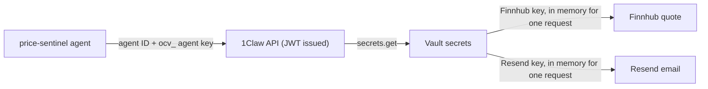
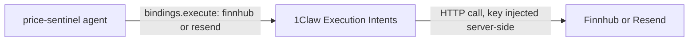

# price-sentinel

A small Node.js agent that checks a price on a schedule and emails you when it crosses a threshold. It watches US stock quotes (e.g. `AAPL`, `NVDA`) via [Finnhub](https://finnhub.io)'s free `/quote` endpoint, and sends email via [Resend](https://resend.com).

- Alerts once per crossing. It re-arms when the price moves back across the threshold.
- Crossing state is kept in `.state.json`.
- The Finnhub and Resend API keys live in a [1Claw](https://1claw.co) vault, not in `.env` or the repo.
- The only credentials on disk are the 1Claw agent ID and agent key (`ocv_...`). Both are scoped by a vault policy and can be revoked.

## Modes

| Mode | Requirement | How keys are used |
| --- | --- | --- |
| `vault` (default) | Any 1Claw tier | The agent reads both keys from 1Claw on every check. Keys exist in memory for that one request. |
| `intents` | 1Claw Pro+ | The agent calls 1Claw Execution Intents. 1Claw makes the HTTP call and injects the key server-side. The agent never sees either key. |

### Vault mode



### Intents mode



The agent never handles the key in this mode. Guardrails limit each binding to one host and path.

## Setup

1. **Prerequisites**
   - Node.js 22 or newer.
   - A 1Claw account: https://1claw.co
   - A free Finnhub key: https://finnhub.io/register
   - A Resend key: https://resend.com/api-keys
   - Without a verified domain, Resend only delivers to your Resend signup email. That is fine for alerting yourself. The sender stays `onboarding@resend.dev`.

2. **Clone and install**

   ```sh
   git clone https://github.com/Olariu-Al/price-sentinel && cd price-sentinel && npm install
   ```

3. **Provision a 1Claw agent and vault**

   ```sh
   npx @1claw/cli setup
   ```

   This opens a browser login. It provisions an agent and a vault, and writes the 1Claw MCP server config into your editor (Claude Code, Cursor, VS Code, etc.), so your editor's agent can reach the vault too. The agent key (`ocv_...`) is stored as `ONECLAW_AGENT_API_KEY` in that MCP config.

   Install the CLI for the following steps:

   ```sh
   npm i -g @1claw/cli
   ```

   Get your IDs:

   ```sh
   1claw vault list
   1claw agent list
   ```

   Alternative: create a dedicated agent. This prints a one-time `ocv_` key.

   ```sh
   1claw agent create price-sentinel --vault-ids <vault-id>
   ```

4. **Store the keys**

   ```sh
   1claw secret set price-sentinel/finnhub-api-key --value "<finnhub key>" -v <vault-id>
   1claw secret set price-sentinel/resend-api-key --value "<resend key>" -v <vault-id>
   ```

   To keep keys out of shell history, use `--stdin`:

   ```sh
   printf %s "$KEY" | 1claw secret set price-sentinel/finnhub-api-key --stdin -v <vault-id>
   ```

5. **Least privilege**

   `setup` grants the agent broad access. Add a read-only policy scoped to this project:

   ```sh
   1claw policy create -v <vault-id> --principal-type agent --principal-id <agent-id> --path "price-sentinel/*" --permissions read
   ```

   Then remove the broad policy that `setup` created:

   ```sh
   1claw policy list -v <vault-id>
   1claw policy delete -v <vault-id> <policy-id>
   ```

6. **Configure `.env`**

   ```sh
   cp .env.example .env
   ```

   Fill in `ONECLAW_AGENT_ID`, `ONECLAW_AGENT_API_KEY`, `ONECLAW_VAULT_ID`, `SYMBOL`, `THRESHOLD`, `DIRECTION`, and `ALERT_TO`. All variables are listed in the table below.

7. **Run**

   ```sh
   npm run once   # a single check, good for testing
   npm start      # loop every INTERVAL_SECONDS
   ```

   To test the email path, set `THRESHOLD` below the current price with `DIRECTION=above`. The next check should trigger an alert.

   Cron alternative (every 5 minutes):

   Cron does not load nvm, so use the absolute path to `node` (find it with `which node`):

   ```cron
   */5 * * * * cd /path/to/price-sentinel && /path/to/node --env-file=.env src/index.js --once >> sentinel.log 2>&1
   ```

8. **Optional: intents mode (Pro)**

   Bindings can only be created by a human, not by the agent. Run these once:

   ```sh
   1claw agent update <agent-id> --execution-intents true

   1claw agent binding create <agent-id> --name finnhub --type http \
     --config '{"base_url":"https://finnhub.io","auth_type":"header","auth_header":"X-Finnhub-Token"}' \
     --guardrails '{"allowed_hosts":["finnhub.io"],"allowed_paths":["/api/v1/quote*"]}' \
     --vault-ref <vault-id>:price-sentinel/finnhub-api-key

   1claw agent binding create <agent-id> --name resend --type http \
     --config '{"base_url":"https://api.resend.com","auth_type":"bearer"}' \
     --guardrails '{"allowed_hosts":["api.resend.com"],"allowed_paths":["/emails"]}' \
     --vault-ref <vault-id>:price-sentinel/resend-api-key

   1claw policy create -v <vault-id> --principal-type agent --principal-id <agent-id> --path "price-sentinel/*" --permissions use
   ```

   Then set `MODE=intents` in `.env`.

   Note: with `use` and no `read` policy, the vault can inject the keys but the agent cannot read the plaintext. If you want intents-only, remove the read policy.

   `use` comes from 1Claw's binding docs (the CLI help only lists `read, write, delete`). If a binding call is denied, add `read` as well.

   Check that each binding works, then inspect executions:

   ```sh
   1claw agent binding list <agent-id>
   1claw agent binding test <agent-id> <binding-id>
   1claw agent binding executions <agent-id>
   ```

   If intents mode misbehaves on your account, switch back to `MODE=vault`; it needs nothing beyond the vault and a read policy.

## Using the vault from your editor's agent (MCP)

`npx @1claw/cli setup` registers the 1Claw MCP server with your editor, so its AI agent can manage this project's secrets without you pasting keys into chat or files. For example, ask it:

- "List the secrets under `price-sentinel/` in my 1Claw vault." (`list_secrets`)
- "Store this as `price-sentinel/resend-api-key`." (`put_secret`)
- "Show the recent executions of the `finnhub` binding." (`list_executions`)

The editor agent and price-sentinel are separate principals: each has its own key and policy, and both show up in the audit log.

## Where 1Claw comes in

| Problem | 1Claw feature |
| --- | --- |
| No keys in `.env` or the repo | Vault |
| Least privilege | Path-glob policies (`price-sentinel/*`) |
| Rotation without a redeploy | Per-check fetch in vault mode |
| Visibility | Audit log: `1claw audit list --vault <vault-id>` |
| Agent never sees keys | Execution Intents (intents mode) |
| Editor agent access | MCP server written by `npx @1claw/cli setup` |

## Rotate a key

```sh
1claw secret set price-sentinel/resend-api-key --value "<new key>" -v <vault-id>
```

No restart is needed. The next check uses the new value in both modes: vault mode reads it fresh, and intents bindings point at the secret path (`--vault-ref`), not a copy. Every read appears in the 1Claw audit log.

## Configuration

| Variable | Default | Notes |
| --- | --- | --- |
| `ONECLAW_AGENT_ID` | none | Required. Agent ID from `1claw agent list`. |
| `ONECLAW_AGENT_API_KEY` | none | Required. Agent key, `ocv_...`. |
| `ONECLAW_VAULT_ID` | none | Required in vault mode. Vault ID from `1claw vault list`. |
| `ONECLAW_BASE_URL` | `https://api.1claw.co` | 1Claw API base URL. |
| `SYMBOL` | none | Finnhub symbol, e.g. `AAPL`. Crypto/forex symbols such as `BINANCE:BTCUSDT` depend on your Finnhub plan. |
| `THRESHOLD` | none | Price level to watch. |
| `DIRECTION` | `above` | `above` or `below`. |
| `ALERT_TO` | none | Recipient email address. |
| `ALERT_FROM` | `Price Sentinel <onboarding@resend.dev>` | Sender. Must be on a verified domain unless it is `onboarding@resend.dev`. |
| `INTERVAL_SECONDS` | `300` | Minimum `30`. Used by `npm start`. |
| `MODE` | `vault` | `vault` or `intents`. |
| `FINNHUB_SECRET_PATH` | `price-sentinel/finnhub-api-key` | Vault path of the Finnhub key. |
| `RESEND_SECRET_PATH` | `price-sentinel/resend-api-key` | Vault path of the Resend key. |
| `FINNHUB_BINDING` | `finnhub` | Intents mode. Binding name for Finnhub. |
| `RESEND_BINDING` | `resend` | Intents mode. Binding name for Resend. |
| `STATE_FILE` | `.state.json` | Crossing state file. |

## Tests

```sh
npm test
```

Uses `node:test`. No network access; everything is mocked.

## Security notes

- Secret values are never logged.
- `.env` holds only the agent key. That key is revocable and scoped by policy.
- To cut off access instantly, revoke the agent in 1Claw.

## Troubleshooting

| Symptom | Cause and fix |
| --- | --- |
| `403 forbidden` | The policy does not cover the secret path. Check `1claw policy list` and the `price-sentinel/*` policy. |
| `unknown symbol` | Finnhub returned price `0`: the symbol is wrong or not covered by your Finnhub plan. Try a US ticker such as `AAPL`. |
| Resend `403` or `422` | The recipient is not your Resend signup email, or the `ALERT_FROM` address is not on a verified domain. |
| `denied` or `guardrail_violation` (intents mode) | Check the binding guardrails and confirm execution intents are enabled on the agent. |

## Project layout

```
src/config.js      env validation
src/vault.js       1Claw client and secret reads
src/providers.js   direct (vault) vs intents providers
src/alert.js       crossing logic and state
src/index.js       loop and --once
test/              tests
```

## License

MIT
